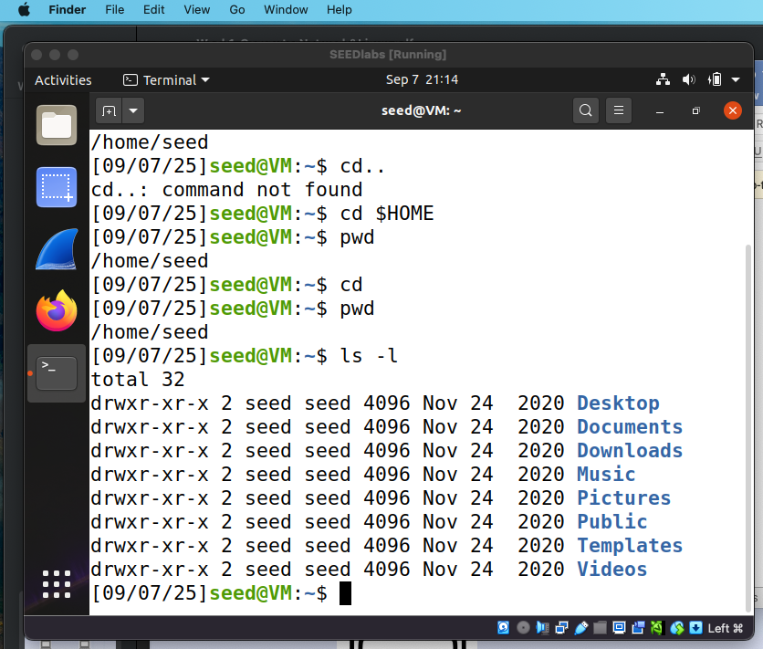
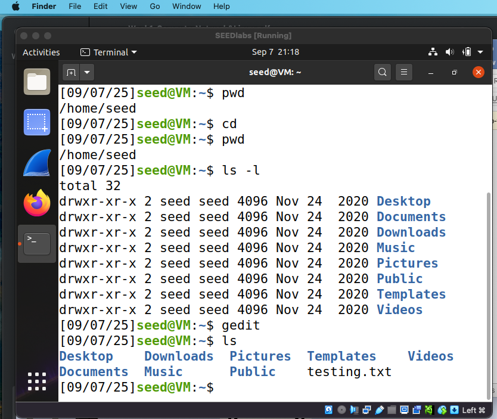

# Lab 01 — VM Environment Setup

**Course:** CYB623 — Network Security and Defense
**Goal:** Stand up a safe, reproducible security lab: install VirtualBox, deploy the pre-built SEED Ubuntu 20.04 VM, and get comfortable working at the Linux command line.

This write-up documents the lab procedure, the commands run in the VM, and the results captured in the screenshots under `assets/`. The setup steps follow the course instructions and the [SEED VM manual](https://github.com/seed-labs/seed-labs/blob/master/manuals/vm/seedvm-manual.md).

## Objectives

1. Inventory the host hardware and OS (useful later for troubleshooting).
2. Install Oracle VirtualBox with the Extension Pack.
3. Deploy the pre-built SEED Ubuntu 20.04 VM.
4. Practice core Linux commands: navigation, file creation, and network interface inspection.

## Host Environment

| Component | Value |
|-----------|-------|
| OS | macOS Monterey 12.7.6 |
| Model | MacBook Air (13-inch, 2017) |
| CPU | 1.8 GHz Dual-Core Intel Core i5 |
| RAM | 8 GB DDR3 |

With 8 GB of RAM, the host matches the lab's recommended (not just minimum) memory spec.

## Step 1 — Install VirtualBox

Per the lab instructions: download the latest VirtualBox for macOS hosts plus the matching Extension Pack from [Oracle's downloads page](https://www.oracle.com/virtualization/technologies/vm/downloads/virtualbox-downloads.html), install the main application first, then add the Extension Pack on top.

## Step 2 — Deploy the SEED VM

Per the lab instructions: download the pre-built SEED Ubuntu 20.04 VM from [seedsecuritylabs.org](https://seedsecuritylabs.org/labsetup.html), import it into VirtualBox following the [SEED VM manual](https://github.com/seed-labs/seed-labs/blob/master/manuals/vm/seedvm-manual.md) (including appendices A–C), and log in with the standard SEED VM account. The deployed VM is the environment captured in the screenshots below.

## Step 3 — Linux Command-Line Fundamentals

All commands were run in the VM's terminal as the `seed` user.

### Home directory & navigation

```bash
echo $HOME      # prints the home directory
cd ..           # move up one level
pwd            # print the current directory
cd             # return home (also: cd $HOME)
pwd            # confirm you are back in /home/seed
```

Running `echo $HOME` and `pwd` showed the home directory is `/home/seed`.

### Listing directory contents

```bash
ls -l
```

The session captured below shows these commands in action (including a `cd..` typo — see Takeaways) and the `ls -l` listing of the standard Ubuntu user folders (`Desktop`, `Documents`, `Downloads`, `Music`, `Pictures`, `Public`, `Templates`, `Videos`):



### Creating a file

```bash
gedit testing.txt
ls
```

Created `testing.txt` with gedit and verified it appears in the home directory listing:



### Network interface inspection

```bash
sudo ifconfig
```

| Interface | IP Address |
|-----------|------------|
| `docker0` | 172.17.0.1 |
| `enp0s3` | 10.0.2.15 |

## Cleanup

Recommended practice: shut the VM down cleanly via the power-off button (upper-right corner of the VM screen) rather than killing the process, so the disk image stays consistent.

## Takeaways

- Setting up VirtualBox + the SEED VM provides an isolated VM environment for security coursework, separate from the host machine.
- Core navigation (`cd`, `pwd`, `ls`) and file creation (`gedit`) practiced hands-on.
- One gotcha worth remembering: `cd..` (no space) fails with `command not found` — the correct form is `cd ..` with a space. Small syntax details matter at the command line.

## Acknowledgments

This lab is based on the [SEED Labs](https://seedsecuritylabs.org/) project (Wenliang Du, Syracuse University), used in coursework at Pace University.
