# Lab 02 — Docker Network Environment

**Course:** Network Security and Defense
**Goal:** Build a virtual network of Docker containers inside the SEED VM, verify connectivity between hosts, scan the network with nmap, and extend the environment with a custom Docker network.

This write-up documents the commands run and results captured in the screenshots under `assets/`. The environment is based on the [SEED Labs](https://seedsecuritylabs.org/Labs_20.04/Networking/Sniffing_Spoofing/) sniffing/spoofing lab setup, deployed with Docker Compose per the course instructions.

## Objectives

1. Deploy a three-host lab network with Docker Compose.
2. Verify host-to-host connectivity with `ping`.
3. Discover live hosts and open ports with `nmap`.
4. (Extra credit) Create a custom `192.168.40.0/24` Docker network from a modified compose file.

## Network Topology

The lab network is `net-10.9.0.0` (`10.9.0.0/24`). From the [upstream compose file](https://github.com/seed-labs/seed-labs/tree/master/category-network/Sniffing_Spoofing/Labsetup) and the commands below:

- **hostA-10.9.0.5** and **hostB-10.9.0.6** are containers with fixed addresses `10.9.0.5` and `10.9.0.6` on the `net-10.9.0.0` bridge network.
- **seed-attacker** is a container configured with `network_mode: host` — it shares the VM's own network stack instead of getting a separate address on the subnet.
- The VM itself is attached to the bridge through interface `br-39f19d123313` (named after the network ID), which holds `10.9.0.1`.

```
                 10.9.0.0/24  (net-10.9.0.0)
 ┌───────────────┐  ┌───────────────┐
 │    Host A     │  │    Host B     │
 │ hostA-10.9.0.5│  │ hostB-10.9.0.6│
 └───────────────┘  └───────────────┘
         ▲                  ▲
         └───── bridge ─────┘
        br-39f19d123313 (10.9.0.1)
        SEED VM + seed-attacker (host networking)
```

All containers are built from the `handsonsecurity/seed-ubuntu:large` image.

## Exercise I — Environment Setup

Downloaded the lab's `Labsetup.zip` from the [SEED Labs site](https://seedsecuritylabs.org/Labs_20.04/Files/Sniffing_Spoofing/Labsetup.zip), extracted it to `~/lab2`, and reviewed the contents — a `docker-compose.yml` file and a `volumes/` folder for file sharing:

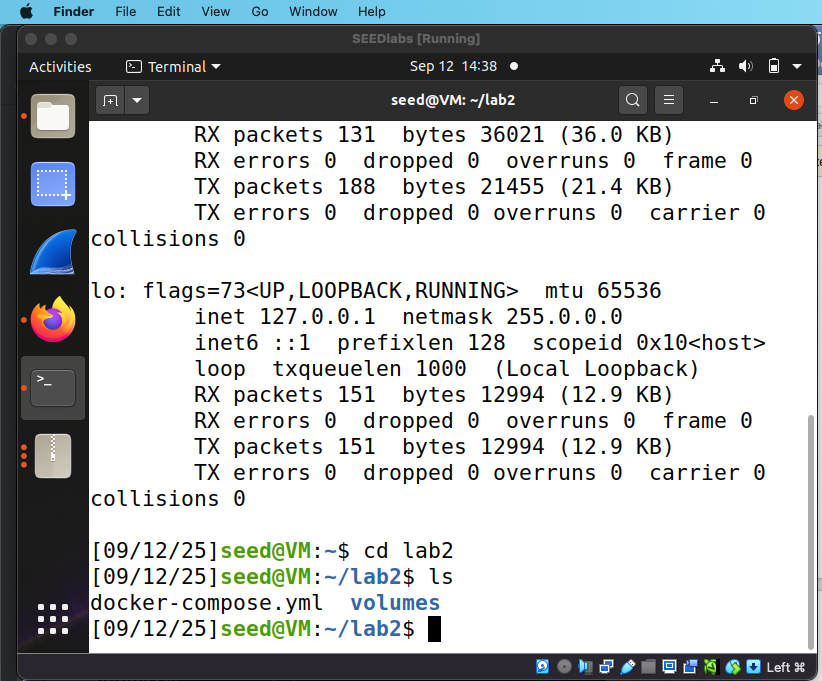

Built and started the stack (the `up` command keeps running in its own terminal — closing it stops the servers, so the rest of the work happens in a second terminal):

```bash
docker-compose build
docker-compose up
```

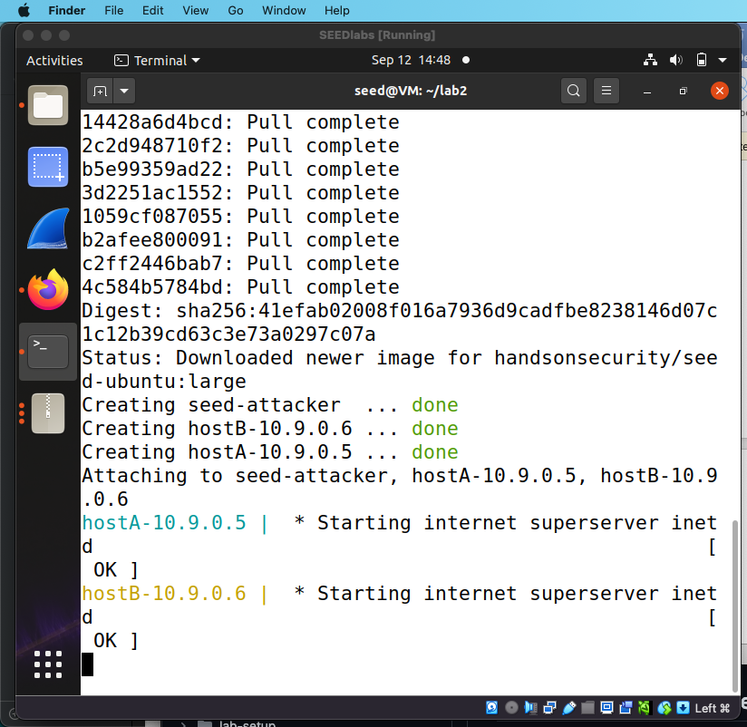

Verified the environment from the host side:

```bash
docker image ls     # view the image used to create the network
docker network ls   # lists net-10.9.0.0 among bridge/host/null networks
docker ps          # lists the running containers
```

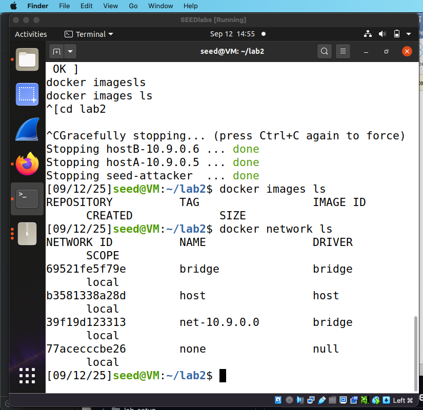

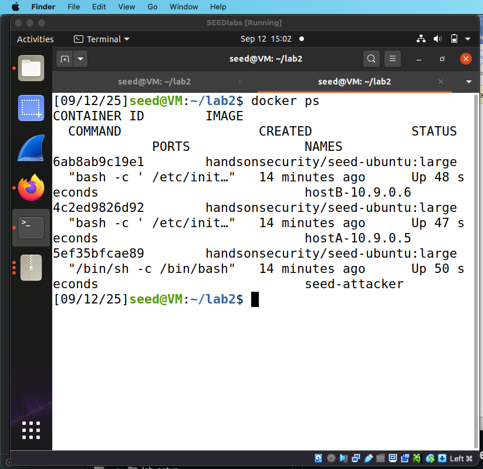

`docker ps` showed the three containers — `hostA-10.9.0.5`, `hostB-10.9.0.6`, and `seed-attacker` — all built from `handsonsecurity/seed-ubuntu:large`. The VM's interface with IP `10.9.0.1` is `br-39f19d123313`.

## Exercise II — Ping Between Hosts

The lab procedure: open a new terminal, log into host `10.9.0.6` with `docksh <container-id>` (or `docker exec -it <container-id> /bin/bash` — only the first 2–3 letters of the ID are needed), verify the IP with `ifconfig`, then ping the other host:

```bash
docksh <container-id>
ifconfig
ping 10.9.0.5
```

The ping succeeded — 8 packets transmitted, 8 received, 0% loss. The screenshot shows the shell running as `root@6ab8ab9c19e1`, matching the `hostB-10.9.0.6` container ID from `docker ps`:


Left the container with `exit` to return to the VM:

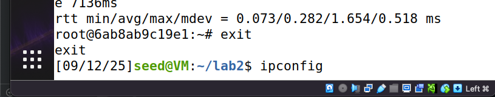

## Exercise III — Scanning the Docker Network with nmap

Installed nmap on the main VM first (many lab commands need `sudo`):

```bash
sudo apt-get update
sudo apt-get install nmap
```

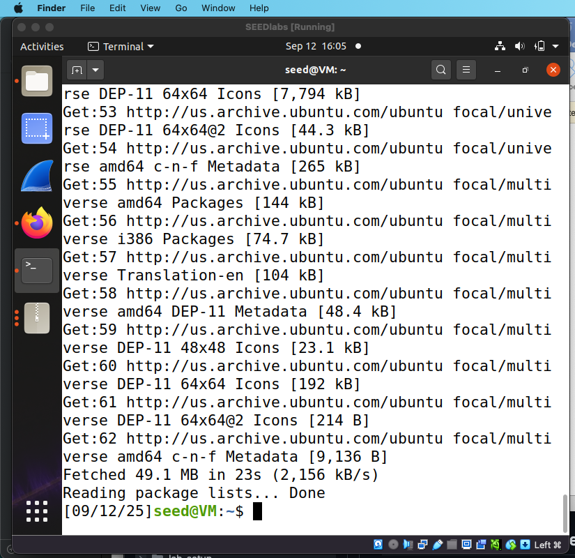

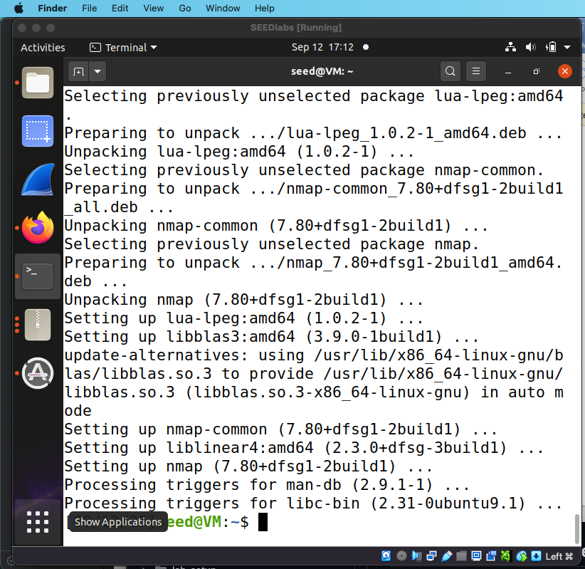

Then scanned the whole lab subnet:

```bash
sudo nmap 10.9.0.0/24
```

All three hosts were up:

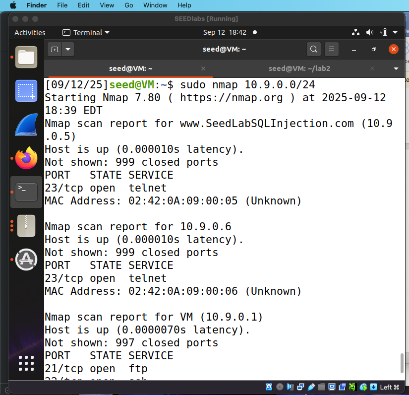

The scan output for `10.9.0.1` is partially cut off in the screenshot; the open ports recorded in the lab report:

| Host | IP | Open TCP ports |
|------|----|----------------|
| Attacker (VM) | 10.9.0.1 | 21 (ftp), 22 (ssh), 23 (telnet) |
| Host A | 10.9.0.5 | 23 (telnet) |
| Host B | 10.9.0.6 | 23 (telnet) |

## Optional Exercise — Custom Docker Network (extra credit)

Modified the `docker-compose.yml` to build a `192.168.40.0/24` network with three hosts (`hostA-192.168.40.5`, `hostB-192.168.40.6`, plus the attacker).

First attempt hit a conflict with the still-existing `seed-attacker` container from the earlier network. Fixed it by renaming the new container to `seed-attacker2`:

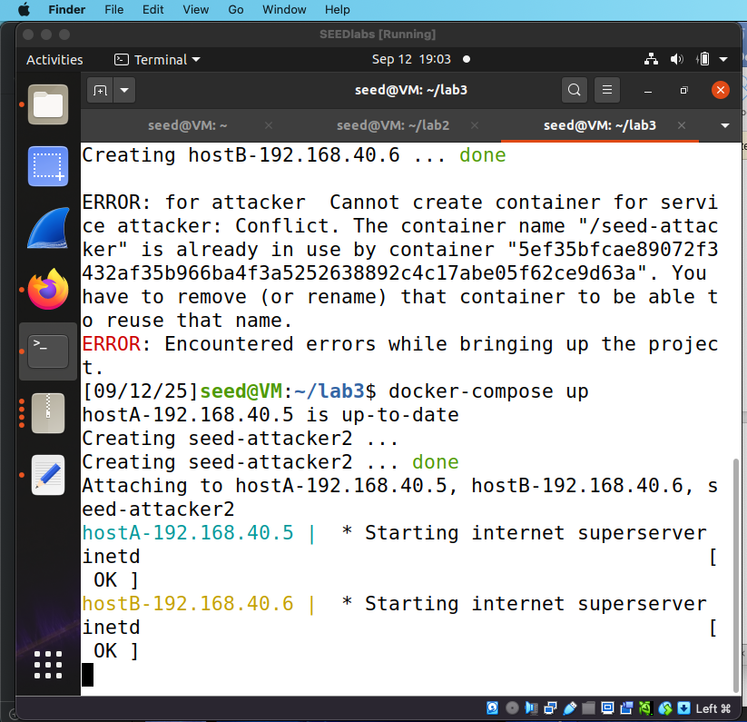

Then scanned the new subnet to prove the hosts weren't just created but reachable, with open ports visible on each:

```bash
nmap 192.168.40.0/24
```

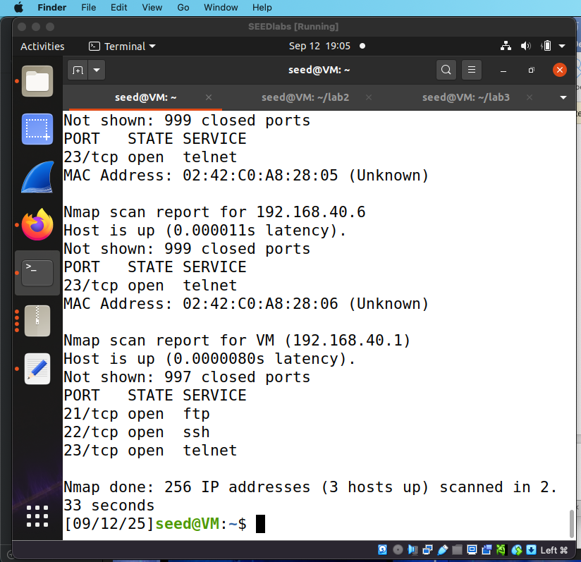

| Host | IP | Open TCP ports |
|------|----|----------------|
| Attacker (VM) | 192.168.40.1 | 21 (ftp), 22 (ssh), 23 (telnet) |
| Host A | 192.168.40.5 | 23 (telnet) |
| Host B | 192.168.40.6 | 23 (telnet) |

## Cleanup

Procedure: tear the environment down and confirm nothing is left running.

```bash
docker-compose down
docker ps
```

At capture time, `docker ps` showed no running containers:

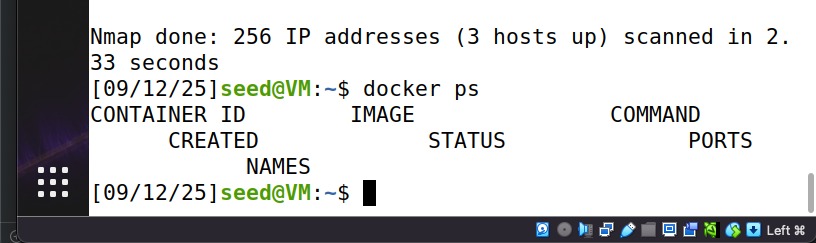

## Takeaways

- Docker Compose makes a multi-host security lab reproducible — one `yml` file defines the entire network topology, and `docker-compose down` tears it all down.
- `docksh <id-prefix>` / `docker exec -it` is a quick way to hop between hosts on the lab network.
- nmap maps a subnet's live hosts and open ports in one command — a core reconnaissance skill.
- Real-world debugging: a compose container name colliding with an existing container (`seed-attacker`) fails with a name-conflict error; renaming resolves it. Read the error, fix the config, re-run.
- The scans in this lab targeted the lab subnets `10.9.0.0/24` and `192.168.40.0/24`, inside a VM built for the exercise.

## Acknowledgments

The environment is adopted from the SEED Labs 2.0 sniffing/spoofing lab (see the [original lab](https://seedsecuritylabs.org/Labs_20.04/Networking/Sniffing_Spoofing/) and the [SEED Docker manual](https://github.com/seed-labs/seed-labs/blob/master/manuals/docker/SEEDManual-Container.md)). The lab work, observations, and write-ups are my own.
