# Lab 03 — Packet Sniffing and Spoofing

**Course:** Network Security and Defense
**Goal:** Capture live traffic on a Docker lab network with Wireshark, write a packet sniffer in Python with Scapy, and craft spoofed ICMP and UDP packets to understand how trivially source addresses can be forged — and why that matters.

This write-up documents the commands run and results captured in the screenshots under `assets/`. The environment is based on the [SEED Labs](https://seedsecuritylabs.org/Labs_20.04/Networking/Sniffing_Spoofing/) sniffing/spoofing lab (same Docker setup as [Lab 02](../lab-02-docker-network-environment)), with scripts from the [SEED book code](https://github.com/kevin-w-du/BookCode).

## Objectives

1. Deploy the three-host Docker lab network (attacker at 10.9.0.1, Host A at 10.9.0.5, Host B at 10.9.0.6).
2. Sniff ICMP traffic with Wireshark and with a custom Scapy sniffer.
3. Send spoofed ICMP and UDP packets from the attacker and observe the responses they trigger.
4. Discuss the risks of sniffing and spoofing.

## Environment

Same topology as Lab 02 — the SEED VM (attacker, 10.9.0.1) plus containers `hostA-10.9.0.5`, `hostB-10.9.0.6`, and `seed-attacker` on the `10.9.0.0/24` Docker network. This time the lab setup folder was extracted to `~/Lab3`.

One detail worth knowing: the Docker bridge interface gets a **new name every time the network is recreated**. In this session it was `br-7e43fd6a5cc2` (in Lab 02 it was `br-39f19d123313`) — that name has to be found with `ifconfig` and plugged into the capture tools each time.

## Exercise I — Environment Setup

Extracted `Labsetup.zip` to `~/Lab3`, confirmed the `docker-compose.yml` and `volumes/` folder were in place, then brought the network up:

```bash
docker-compose build
docker-compose up
docker ps        # or: dockps
```

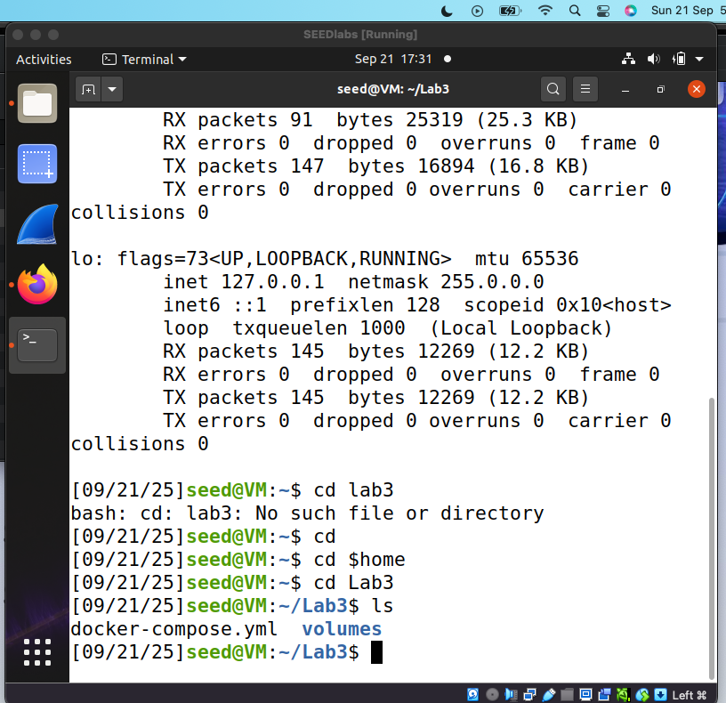

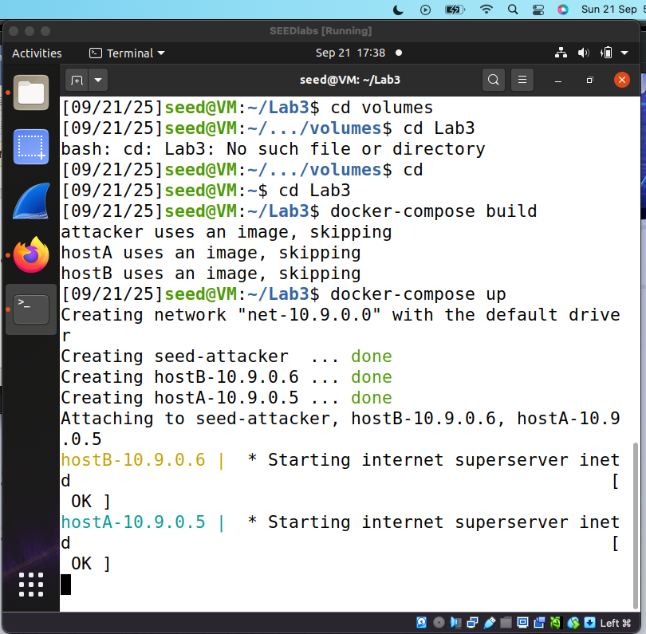

`docker ps` showed the three containers up — `hostA-10.9.0.5`, `hostB-10.9.0.6`, and `seed-attacker`:

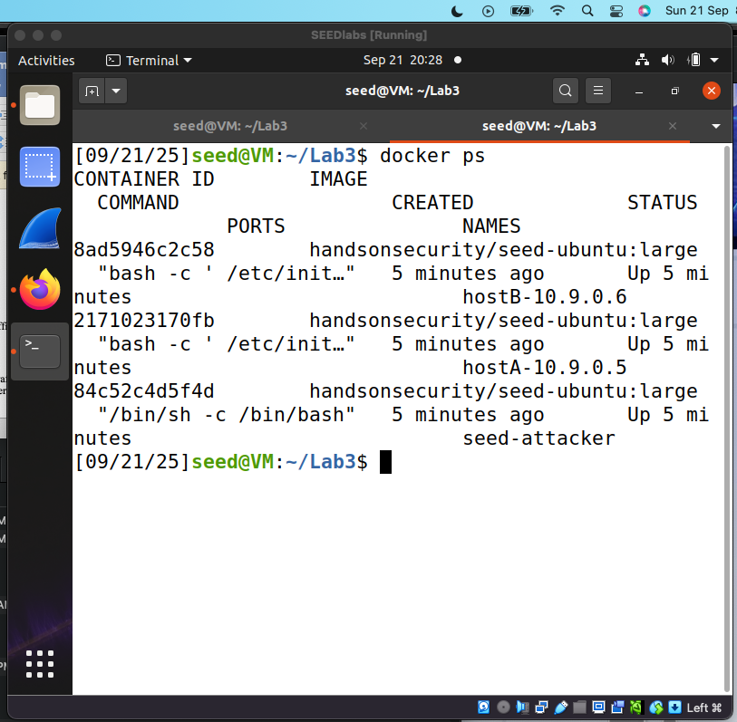

## Exercise II — Sniffing with Wireshark

Opened a shell in the attacker environment and launched Wireshark on the VM, capturing on the lab's bridge interface (`br-7e43fd6a5cc2` — the adapter holding 10.9.0.1):

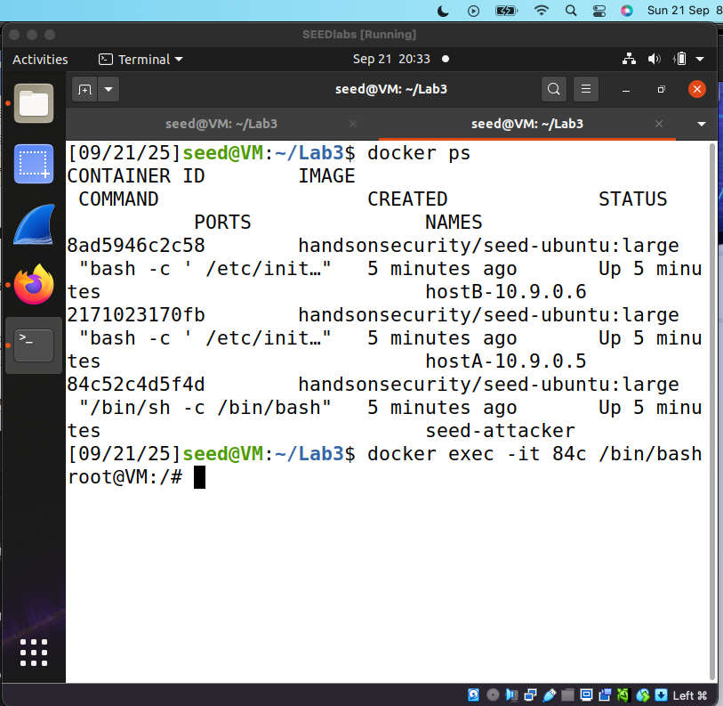

From a second terminal, logged into Host B and pinged Host A:

```bash
docksh <container-id>
ifconfig
ping 10.9.0.5
```

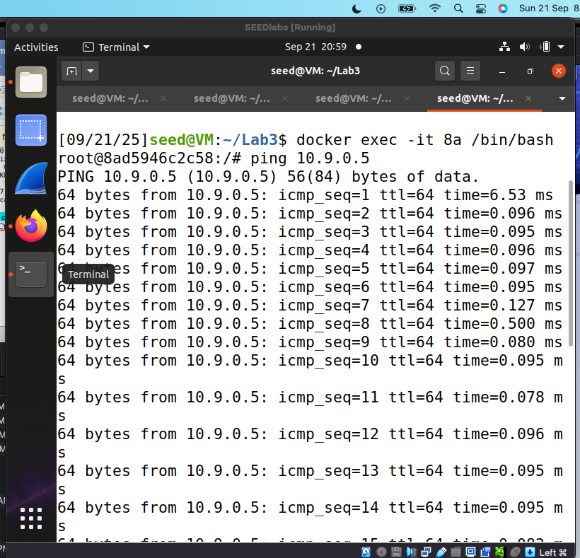

Wireshark captured the full conversation — ICMP Echo Request / Echo Reply pairs between 10.9.0.6 and 10.9.0.5, 30 packets total. The detail pane of a selected reply shows the full stack: Ethernet frame, IPv4 (10.9.0.5 → 10.9.0.6), then ICMP:

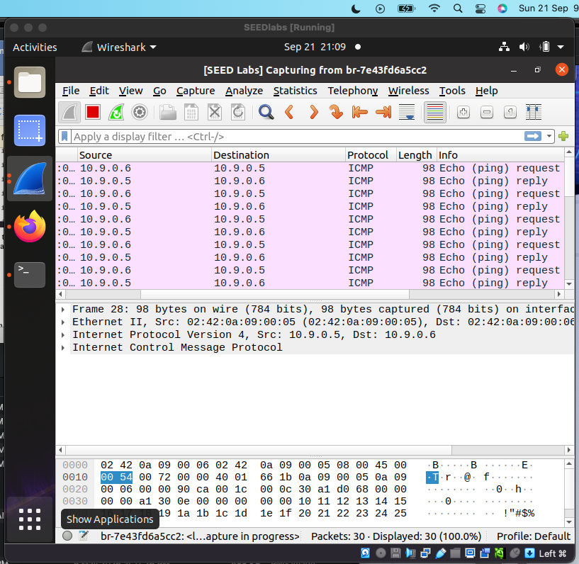

## Exercise III — Sniffing with Scapy

The SEED `sniffer.py` script uses Scapy's `sniff()` to print the source, destination, and protocol of every captured packet. Before running it, the `iface` in the last line had to be changed to this session's bridge interface:

```python
#!/usr/bin/env python3
from scapy.all import *

print("SNIFFING PACKETS.........")

def print_pkt(pkt):
    print("Source IP:", pkt[IP].src)
    print("Destination IP:", pkt[IP].dst)
    print("Protocol:", pkt[IP].proto)
    print("\n")
    #pkt.show()

pkt = sniff(iface='br-7e43fd6a5cc2', filter='icmp', prn=print_pkt)
```

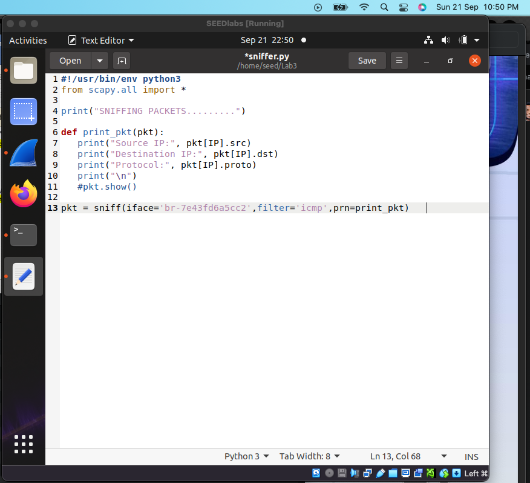

Ran it with `sudo` (raw packet capture needs elevated privileges), then pinged 10.9.0.6 from 10.9.0.5 in another terminal. The sniffer printed each packet as it flew by — source, destination, and protocol 1 (ICMP):

```bash
sudo python3 sniffer.py
```

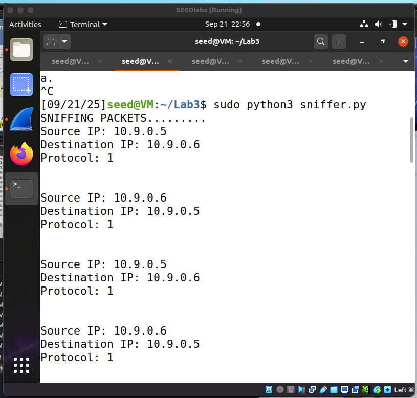

A few lines of Python reproduce what Wireshark does — proof that sniffing only requires a privileged position on the network.

## Exercise IV — ICMP Spoofing

The `icmp_spoof.py` script crafts an ICMP packet with a **forged source address** (`1.2.3.4`) and sends it to Host B from the attacker. With Wireshark monitoring the bridge, running the script showed both the spoofed packet and the consequence:

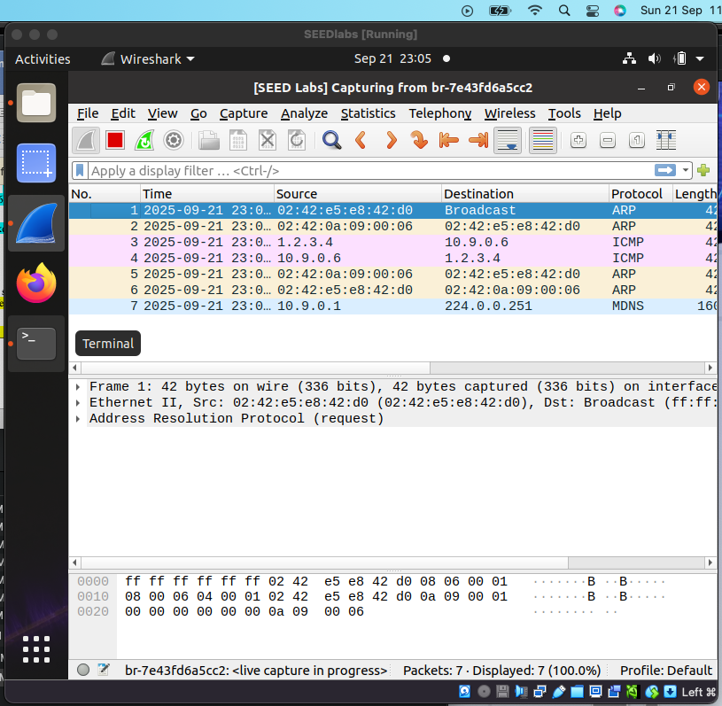

Host B received the packet appearing to come from `1.2.3.4` and dutifully sent its ICMP reply **to the spoofed address** — the reply goes to whoever actually owns the forged source, not the attacker. That asymmetry is the core of many reflection-based attacks.

**Risk:** forged-source ICMP enables DoS — ping floods that overwhelm a target with traffic, and reflection/amplification where replies are aimed at a victim the attacker chooses.

## Exercise V — UDP Spoofing

The `udp_spoof.py` script crafts a UDP packet with Scapy — arbitrary ports, arbitrary payload — and sends it to Host B, with Wireshark monitoring:

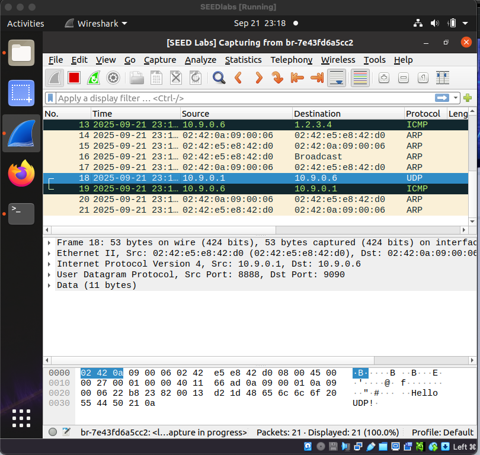

The capture shows the UDP packet to Host B (destination port 9090) carrying the `Hello UDP!` payload, and Host B's ICMP response. Scapy builds every header field by hand — nothing about the packet comes from a real socket.

**Risk:** because UDP is connectionless and trivially spoofable, forged-source UDP is the basis of large-scale volumetric attacks — floods of UDP packets with spoofed source addresses overwhelming systems, and amplification abuse of UDP services.

## Cleanup

Tore the environment down and confirmed nothing was left running:

```bash
docker-compose down
docker ps      # empty
```

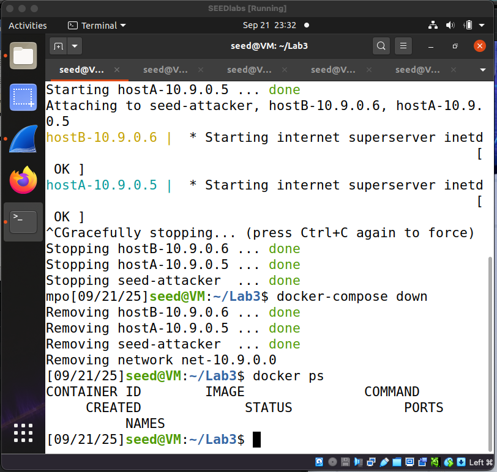

## Takeaways

- Position is privilege: anyone who can see a network's traffic can capture it — Wireshark needs no attack tooling, and a 15-line Scapy script is a working sniffer.
- Scapy makes spoofing trivial: source addresses are just header fields you set. The ICMP capture shows Host B replying to the forged `1.2.3.4` — the foundation of reflection attacks.
- Practical gotcha solved: getting the Python scripts onto the VM — the lab's `volumes/` folder is shared between the VM and the containers, so dropping the scripts there made them available everywhere.
- The Docker bridge interface changes names on every recreation, so capture tools and scripts need the current interface name each session — check it with `ifconfig` first.
- Reading a script before running it paid off: understanding `sniffer.py`'s `sniff()` call made the interface fix obvious.

## Acknowledgments

The environment and scripts are adopted from the SEED Labs 2.0 sniffing/spoofing lab (see the [original lab](https://seedsecuritylabs.org/Labs_20.04/Networking/Sniffing_Spoofing/) and the [SEED book code](https://github.com/kevin-w-du/BookCode)). The lab work, observations, and write-ups are my own.
